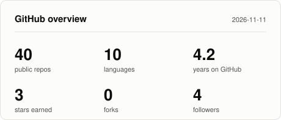
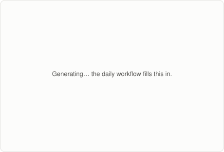

<h2 align="center">Hi 👋 I'm Victor</h2>

I turn **official statistics into animated video** — bar-chart races, animated
historical maps, 3D data scenes — and write the Python that renders them. The
rest of my time goes to small engineering and automation tools.

- 🎬 Data-driven video: rendering pipelines built on Python, ffmpeg and Skia
- 🗺️ Animated maps and 3D scenes from public datasets
- 🛠️ Desktop and automation utilities: file tooling, device control, documentation generators
- 🌐 Web: React, Django and plain JavaScript from my front-end years

## Recent work

<!-- RECENT:START -->

| Project | What it is | Language | Last push |
| --- | --- | --- | --- |
| [world_gdp_1960_2026](https://github.com/Viton4ik/world_gdp_1960_2026) | Global Government Debt Race (1926 – Oct 2026) \| Auto-Installer & Self-Cleaning MP4 Builder | Python | 2026-11-13 |
| [migration-desire-map](https://github.com/Viton4ik/migration-desire-map) | An animated world-map video (9:43, 1920x1080, 30 fps) for an English-language YouTube cha… | Python | 2026-11-12 |
| [FileDateChanger](https://github.com/Viton4ik/FileDateChanger) | Tiny portable Windows GUI tool to change file creation, modification and access dates and… | C# | 2026-11-11 |
| [Technology-and-Space](https://github.com/Viton4ik/Technology-and-Space) | Space Race: Satellites & Spacecraft in Orbit (1957–2026) | Python | 2026-11-11 |
| [wage-race-project](https://github.com/Viton4ik/wage-race-project) | Minimum Wage vs Average Wage in the EU, 2000-2025 | Python | 2026-11-09 |
| [Tongues-of-the-World](https://github.com/Viton4ik/Tongues-of-the-World) | tongues_of_the_world | JavaScript | 2026-11-06 |

Updated automatically on 2026-11-13.

<!-- RECENT:END -->

## Statistics

<picture><source media="(prefers-color-scheme: dark)" srcset="assets/overview-dark.svg"></picture>
<picture><source media="(prefers-color-scheme: dark)" srcset="assets/languages-dark.svg"></picture>
<!-- DOWNLOADS:START --><!-- DOWNLOADS:END -->

These cards are plain SVG files committed to this repository and refreshed daily
by <a href=".github/workflows/profile-stats.yml">a GitHub Action</a>. No external
stats service is involved, so there is nothing here that can go down.
Source: <a href="scripts/gen_cards.py">scripts/gen_cards.py</a>.

## Contact

[Telegram @Viton4ik](https://t.me/Viton4ik) ·
[viton4ik@gmail.com](mailto:viton4ik@gmail.com) ·
[Personal page](https://viton4ik.github.io/portfolio/)

Bookmarks — front-end and back-end references I keep coming back to

**React ecosystem**
[create-react-app](https://create-react-app.dev/docs/getting-started/) ·
[SyntheticEvent](https://legacy.reactjs.org/docs/events.html#generic-events) ·
[react-devtools](https://github.com/SkillfactoryCoding/react/tree/main/packages/react-devtools) ·
[react-bootstrap](https://react-bootstrap.github.io/docs/components/accordion/) ·
[15 React components](https://techrocks.ru/2017/11/17/15-react-components/) ·
[Redux](https://redux.js.org/) ·
[Next.js](https://nextjs.org/)

**Other front-end**
[Vue](https://ru.vuejs.org/) ·
[Angular](https://angular.io/) ·
[jQuery API](https://api.jquery.com/) ·
[Bootstrap](https://getbootstrap.com/) ·
[npm](https://www.npmjs.com/package) ·
[shields.io](https://shields.io/)

**CSS**
[flexbox.help](https://flexbox.help/) ·
[flexyboxes](https://the-echoplex.net/flexyboxes/) ·
[CSS functions](https://css-tricks.com/complete-guide-to-css-functions/) ·
[nth-child](http://css.yoksel.ru/nth-child/) ·
[CSS loaders](https://loading.io/css/) ·
[Google Fonts](https://fonts.google.com/)

**Testing**
[Cypress](https://www.cypress.io/) ·
[Jest](https://jestjs.io/ru/docs/api)

**Python, servers, infrastructure**
[Django channel layers](https://channels.readthedocs.io/en/stable/topics/channel_layers.html) ·
[Tornado](https://www.tornadoweb.org/en/stable/) ·
[Twisted](https://pypi.org/project/Twisted/) ·
[certbot](https://eff-certbot.readthedocs.io/en/stable/using.html#deleting-certificates) ·
[HTML5 geolocation](https://www.w3schools.com/html/html5_geolocation.asp)

